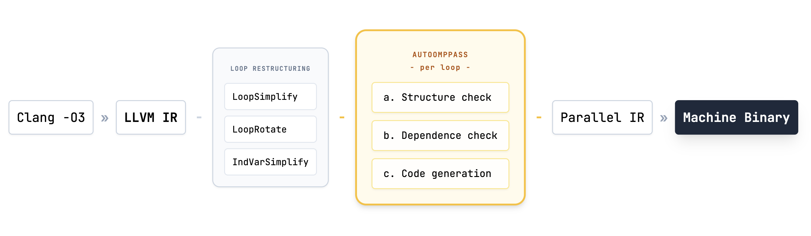
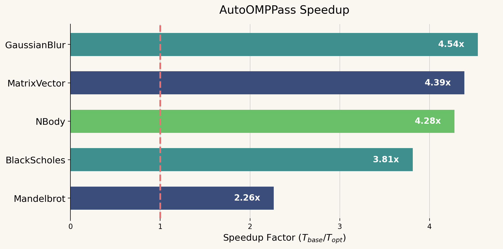

# AutoOMPPass

Out-of-tree LLVM pass for automatic loop parallelization via OpenMP.

Analyzes LLVM IR to find loops safe to parallelize. Handles reductions, privatization, and loop collapsing. Validated on [TSVC](https://www.netlib.org/benchmark/vectors/).

## Pipeline



## Benchmarks



<sub>N = 20M elements, median of 5 runs, -O3</sub>

### Usage

Manually:
```bash
meson setup build
ninja -C build
clang -fpass-plugin=./build/AutoOMPPass.so -O1 input.cpp -o output
```

Or use the helper scripts:
```bash
./scripts/run.sh input.cpp        # build, compile & run
./scripts/check-pass.sh input.cpp # inspect pass remarks only
```

## Tests

```bash
meson test -C build
```
